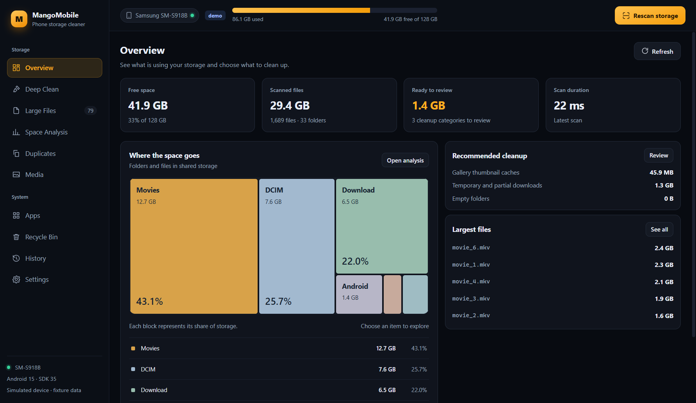
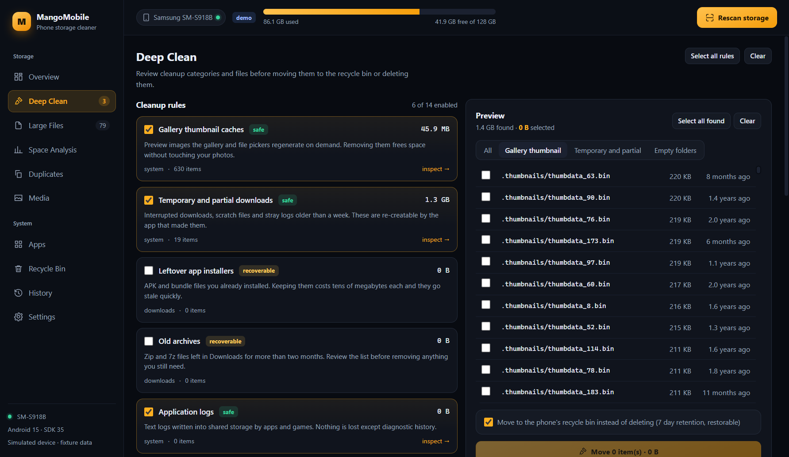
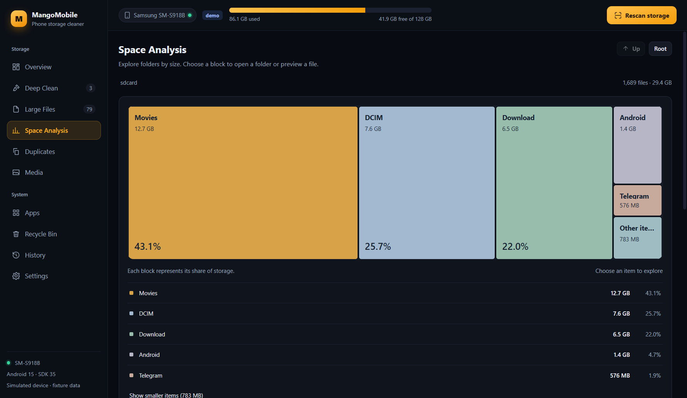
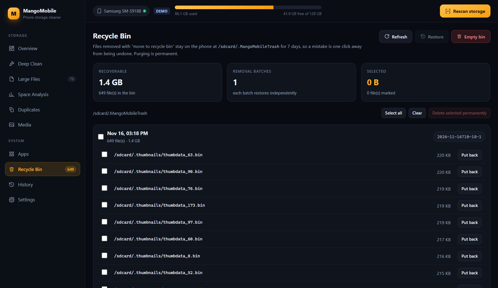

# MangoMobile

[Website](https://visalrazazaidi.github.io/MangoMobile/) | [Download for Windows](https://github.com/VisalRazaZaidi/MangoMobile/releases/latest) | [Report an issue](https://github.com/VisalRazaZaidi/MangoMobile/issues)

## Install

Download the **setup.exe** installer or **portable.exe** from [GitHub Releases](https://github.com/VisalRazaZaidi/MangoMobile/releases/latest). The current builds are unsigned; Windows may show a security warning. Verify downloads against the release's `SHA256SUMS.txt`. Android Platform Tools (`adb`) and USB debugging are required. See Requirements below.

A Windows desktop app for cleaning up an Android phone's storage **without waiting for Windows Explorer to enumerate it over MTP**.

Plug the phone in over USB, and MangoMobile talks to it through ADB instead: one batched `find` + `stat` stream builds a complete file index in seconds, so per-folder browsing, large-file lists, duplicate checks and cleanup all run against local data. Nothing is installed on the phone.

```
USB (ADB) ──► one streamed metadata walk ──► gzip index on the PC ──► instant views
                                                │
                                                ├── preview rules (read-only)
                                                ├── move to on-device recycle bin
                                                └── restore / purge with verification
```

## Why not MTP?

Windows treats a phone as a media device. Every folder expansion round-trips over MTP, which is why opening Internal storage can take tens of seconds. ADB gives a shell on the device, so MangoMobile can ask for *all* file sizes and timestamps in a single command and then work offline from that snapshot.

## Features

Click a filename in Deep Clean, Large Files, Media, Duplicates, Recycle Bin or Space Analysis to open the file preview panel. Supported images display in the panel; video and audio have playback controls; text files are shown as plain text. Other formats and unsupported codecs show file details. Preview reads a temporary copy over ADB; media is limited to 512 MB and text to 1 MB. Large files may take time to transfer. Close the panel with its close button or Escape. Checkboxes continue to select files for cleanup independently.

Windows builds are written to `release/`. After both installers for the current version build successfully, `npm run build:win` removes older versioned installers from that folder.

| Area | What it does |
| --- | --- |
| **Overview** | Volume usage, biggest folders, quick wins, device summary |
| **Deep Clean** | 14 curated rules (thumbnails, caches, logs, temp files, installers, old screenshots, empty folders…) with risk labels, per-item review and a preview-before-delete flow |
| **Large Files** | Everything over a size threshold, grouped by folder, with one-click selection |
| **Space Analysis** | Interactive treemap backed by pre-aggregated directory sizes |
| **Duplicates** | Size + head-hash prefilter, then on-device `md5sum` for exact matches |
| **Media** | Photos, videos, audio, screenshots and documents bucketed by kind and folder |
| **Apps** | Installed packages, APK/data/cache sizes where available, `pm trim-caches`, per-user uninstall |
| **Recycle Bin** | Files moved to `/sdcard/.MangoMobileTrash/<opId>/` with an on-device manifest; restore exactly where they came from, or purge permanently |
| **History** | Every cleanup, restore, purge, uninstall and cache trim, stored locally on the PC |
| **Settings** | adb path, default scan root, recycle-bin retention, size thresholds, theme |

Every destructive action follows the same pipeline:

1. **Read-only scan** – only `find`/`stat`/`ls` style commands run.
2. **Preview** – you see paths, sizes and totals before anything changes.
3. **Explicit confirmation** – the confirmation dialog names the operation.
4. **Execute** – batched moves/deletes on the phone, never file-by-file over USB.
5. **Verify** – the app asks the device what still exists and reports the real outcome.

A second, independent safety layer (`src/main/core/safety.ts`) rejects protected system trees, the recycle bin itself, traversal paths, null bytes, and attempts to delete user media *folders* (individual files inside them are allowed when a rule selected them).

## Screenshots

All screenshots are from the built-in demo device.

| | |
| --- | --- |
|  **Overview** — volume usage, biggest folders, quick wins |  **Deep Clean** — rules with risk labels and per-item review |
|  **Space Analysis** — treemap from pre-aggregated sizes |  **Recycle Bin** — restore or purge, grouped by batch |

More: [large files](docs/screenshots/large-files.png) · [duplicates](docs/screenshots/duplicates.png) · [media](docs/screenshots/media.png) · [apps](docs/screenshots/apps.png) · [history](docs/screenshots/history.png) · [settings](docs/screenshots/settings.png)

## Requirements

- Windows 10/11 (the packaged builds target x64)
- Node.js 22+ for development
- Android phone with **USB debugging** enabled, plus [Android Platform Tools](https://developer.android.com/tools/releases/platform-tools) (`adb`)
- On the phone: accept the "Allow USB debugging" prompt. Some MIUI/HyperOS builds also need **Developer options → USB debugging (Security settings)** for shell access to every folder.

MangoMobile locates `adb` from (in order) the path in Settings, `ADB_PATH`, `ANDROID_SDK_ROOT`/`ANDROID_HOME`, `PATH`, `C:\platform-tools\adb.exe`, and the default SDK location. The adb path can be overridden in **Settings**.

## Getting started

```powershell
cd mangomobile
npm install
npm run dev
```

Then:

1. Connect the phone and enable USB debugging.
2. Click **Scan storage** (first run asks to allow debugging on the phone).
3. Open **Deep Clean**, review the selected rules, and press **Preview** → **Clean now**.

### Try it without a phone

The app ships with a simulated device (a fabricated Galaxy S23-style volume and package list) that speaks the exact same shell-command surface as a real phone.

- On the welcome screen choose **Try the demo device**, or
- launch with `MANGO_DEMO=1`:

```powershell
$env:MANGO_DEMO = "1"; npm run dev     # auto-connects and scans
$env:MANGO_DEMO = "1"; $env:MANGO_VIEW = "clean"; npm run dev
```

Demo mode is labelled **DEMO** in the title bar. It is a fixture, not your data.

### Screenshot automation

`MANGO_CAPTURE` renders the app, saves a PNG and exits:

```powershell
$env:MANGO_DEMO = "1"; $env:MANGO_VIEW = "analysis"; $env:MANGO_CAPTURE = "shot-analysis.png"; npx electron .
```

`MANGO_CAPTURE_DELAY` (milliseconds, default 4500) controls how long it waits before capturing.

## Android 11+ and app caches

Android 11 hides `/sdcard/Android/data` from the shell user on most devices, so a desktop tool cannot read or delete app-internal caches there. MangoMobile probes this instead of assuming:

- If the ROM exposes `Android/data` (MIUI/Xiaomi commonly does, and the Redmi Note 11 test device did), app-cache rules run normally and their folders show up in the index.
- If it is hidden, rules that need that tree are shown as **unavailable**, with an explanation.
- Either way, the **Apps** view offers **Trim system caches** (runs the phone's own `pm trim-caches`).

Removing app data directly is also deliberately avoided; uninstalling is offered per user via `pm uninstall --user 0`.

## Development

```powershell
npm run dev           # electron-vite dev server + Electron
npm run typecheck     # vue-tsc (renderer) + tsc (main/preload)
npm test              # 40 unit/integration tests against the simulator
npm run smoke         # end-to-end: preview -> recycle bin -> restore on the demo device
npm run check:device  # read-only scan of a real phone, prints what it found
npm run shot:device   # same, but renders the app and saves a screenshot
npm run build         # production bundle into out/
npm run build:win     # NSIS installer + portable exe into release/
npm run make:icon     # re-render build/icon.png and build/icon.ico
```

`npm run smoke` launches the built app with a throwaway profile (`MANGO_USERDATA`), drives the preload API over the Chrome DevTools Protocol, checks the recycle-bin UI, and asserts that every moved file is restored to its original path. It writes `shot-smoke-trash.png` and `shot-smoke.png`.

`npm run check:device` uses the same probe + scanner the app uses, but never deletes anything. Pass `-- --serial <serial>` when more than one device is attached:

```powershell
npm run check:device -- --serial 8d3c07c6
```

### Layout

```
src/main/            Electron main process
  adb/               adb transport, device probe, mock device simulator
  core/              scanner, storage index, rules, safety, cleaner, duplicates,
                     media, apps, persistence, session orchestrator
  core/rules/        declarative cleanup rules (android-rules.json)
src/preload/         contextBridge API (window.api)
src/renderer/        Vue 3 + Tailwind UI (views, components, store)
tests/               node:test suites using the simulated device
scripts/             icon generator, CDP smoke test
```

Scanning strategy: one streamed pipeline,

```sh
find -H /sdcard -type f -print0 2>/dev/null | xargs -0 -r -n 500 stat -c '%s|%Y|%n' 2>/dev/null
```

parsed while it runs. Each part exists for a reason found on real hardware:

- `-H` follows `/sdcard` when it is a symlink to `/storage/emulated/0` (MIUI and many other ROMs). Without it the index contains the 21-byte link and nothing else.
- `xargs -n 500` replaces `find -exec stat {} +`, which on a 62k-file volume reported "Argument list too long" and silently dropped whole batches.
- No `-xdev`: `/sdcard/Android/data` is a separate FUSE mount on Android 11+, so `-xdev` would prune exactly the app caches some ROMs expose.

Folders come from a second `find -H /sdcard -type d`. If the device lacks `xargs`/`stat`, the scanner falls back to per-file `stat`, then to `du -a -b -H`. The index is cached as gzip per serial and reused until you rescan. Duplicate hashing uses `md5sum` on the phone, so file contents never cross USB.

## Known limits

- Only the `/sdcard` volume is scanned (the root is configurable); other mounts are out of scope.
- Requires adb and USB debugging; there is no MTP fallback.
- Sizes for installed apps depend on what the ROM's `pm`/`du` exposes; the UI says so when figures are unavailable.
- First scan of a full phone takes roughly 15–30 s over USB (62,560 files / 28.8 GB in 27.6 s on a Redmi Note 11, Android 13). Later views are instant and reuse the cached index.

## License

GPL-3.0-only. See `LICENSE`.

MangoMobile is an independent implementation. Its feature set and architecture were inspired by [MangoDisk](https://github.com/harry0703/MangoDisk) (GPL-3.0), whose source was studied as reference; no MangoDisk code is included in this repository or its build output.
